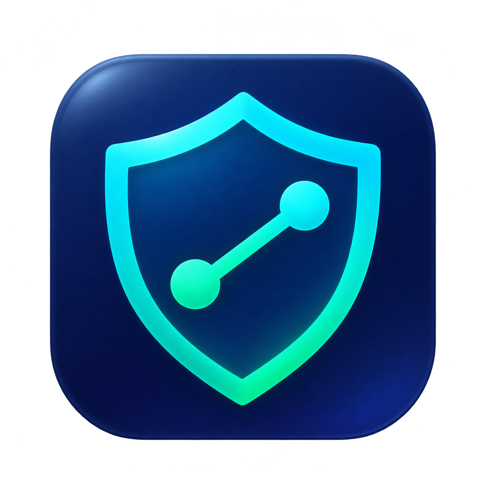
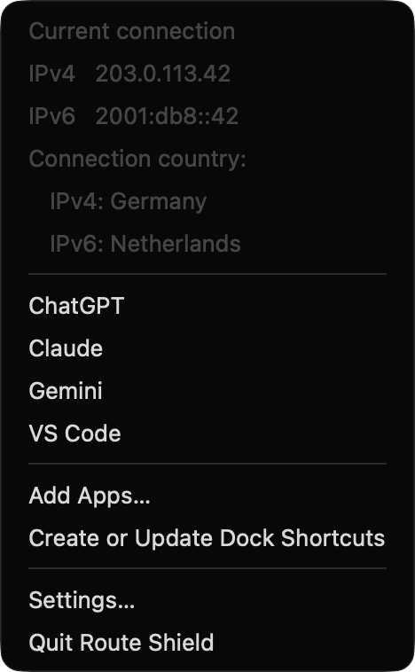
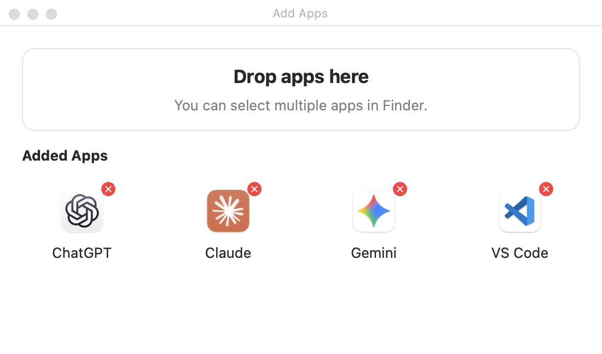
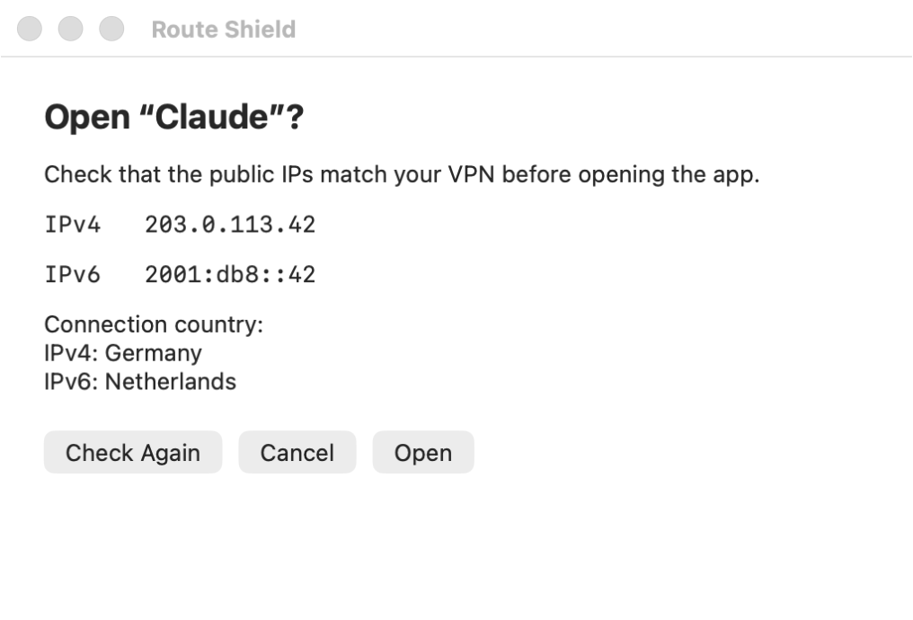

<div align="center">
  
  <h1>Route Shield</h1>
  <p>Check your public IP before opening apps on macOS.</p>
  <p><a href="README.md">Русский</a> · <strong>English</strong></p>
  <p><a href="https://github.com/01trisha/route-shield/releases">Download</a> · <a href="#first-run">First run</a> · <a href="#ip-change-notifications">Notifications</a> · <a href="#from-source">Install from source</a> · <a href="LICENSE">MIT License</a></p>
</div>

Route Shield lives in the menu bar. Add the apps you want to track. To check the connection before opening one, use the Route Shield menu or a Route Shield Dock shortcut. The menu and the prelaunch window show your public IPv4 and IPv6 addresses and the country associated with them.

- **App list.** Drag apps from Finder and Route Shield reads their bundle IDs.
- **Prelaunch IP check.** Open an app through Route Shield to review your public IPv4 and IPv6 addresses and their countries before it starts.
- **Dock shortcuts.** Each shortcut uses the original app's icon and opens the IP check window.
- **IP change notifications.** Choose whether banners show the new IP address, the country, or both.
- **Force-quit on IP changes.** When enabled, Route Shield requests termination of running apps on your list, including apps you opened directly.
- **Russian and English.** Change the interface language and login behavior in Settings.

## Installation

**Requires macOS 13 Ventura or later.** The release build supports both Apple silicon and Intel Macs. IP checks use an internet connection and the system copy of `curl` included with macOS. To build from source, install Git and Xcode Command Line Tools with the macOS 13 SDK or later. A full Xcode installation also works. The build uses only system tools and the Apple toolchain. [Install the Command Line Tools](https://developer.apple.com/documentation/xcode/installing-the-command-line-tools/)

### Prebuilt app

1. Download `Route-Shield-v…-macOS-universal.dmg` from the **Assets** list in [GitHub Releases](https://github.com/01trisha/route-shield/releases).
2. Open the DMG and drag **Route Shield.app** onto the **Applications** shortcut in the disk image. If you downloaded the ZIP, extract it and move the app to **Applications** manually.
3. Open the app from **Applications**. The Route Shield icon appears in the menu bar.

Each download has a matching SHA-256 checksum.

The release build uses an ad hoc signature. If Gatekeeper blocks the downloaded copy, use the source installation below. Distribution with Apple notarization requires a Developer ID signature. [Apple's notarization documentation](https://developer.apple.com/documentation/security/notarizing-macos-software-before-distribution)

### From source

On a new Mac, run `xcode-select --install` and finish the installation in the macOS dialog. If the tools are already installed, proceed with the commands below.

```sh
git clone https://github.com/01trisha/route-shield.git
cd route-shield
./install.sh
```

The script checks the requirements, builds the app, copies it to `/Applications/Route Shield.app`, and opens it. If the Command Line Tools are missing, the script offers to install them through macOS. Run the script again once the tools are installed.

If your account cannot write to `/Applications`, run `./install.sh --user` to install the app in `~/Applications`. Use `--no-open` to install it and open it later.

## First run

On first launch, choose your language, configure IP change notifications, and decide whether to force-quit apps on your list. Select **Done** to save your preferences and open the Route Shield menu. Route Shield suggests Russian if Russian is your preferred macOS language and English for all other languages.

The screenshots use an example app list and test IP addresses.

### Open the Route Shield menu

Click the  icon in the macOS menu bar to see your IPv4 and IPv6 addresses, their countries, and the apps you've added.



### Add apps from Finder

Choose **Add Apps…** and drag one or more apps into the drop area at the top of the window. Click the red cross on an icon to remove that app from the list.



### Check your connection before opening an app

Open the menu again and choose an app such as Claude. Review the IPv4 and IPv6 addresses and their countries, then choose **Open** or **Cancel**.



You can also open tracked apps as usual from Finder, Spotlight, or their original Dock icons. The prelaunch window appears when you open an app through the Route Shield menu or a Route Shield shortcut.

To see the prelaunch window when opening apps from the Dock, choose **Create or Update Dock Shortcuts**. Drag the shortcuts from `~/Applications/Route Shield` into the Dock in place of the original icons.

Choose **Settings…** from the Route Shield menu. In **General**, choose which connection details appear in the menu and the prelaunch window, change the language, or enable launch at login or force-quit. The **About Us** tab links to the GitHub repository.

The app list lives at `~/Library/Application Support/VPN Guard/.env`. To edit it manually, choose **Settings… → General → Open Configuration File…**. Remove IDs from the `APPS=` line or add new IDs separated by commas. The template comments are in English.

If you pinned shortcuts from the old `~/Applications/VPN Guard` folder, recreate them and pin the copies from `~/Applications/Route Shield`. New shortcuts use the language selected in Settings.

After updating Route Shield, choose **Create or Update Dock Shortcuts** so that the shortcuts pick up the new code and translations.

## IP change notifications

Route Shield sends a macOS notification when it detects a change to your public IPv4 or IPv6 address. To receive banners, go to **Settings… → Notifications**, turn on **Notify when the IP changes**, and allow notifications in macOS.

Under **Notification details**, choose **IP address**, **Country**, or **IP address and country**. Select **Test Notification** to see a sample banner with your current connection details.

If force-quit is enabled and Route Shield closes apps after an IP change, a separate notification lists the apps that were closed.

## Updates

**Check for Updates…** is at the top of **Settings… → General**. Route Shield also checks the latest stable release on GitHub when it starts if at least a day has passed since the previous check. While Route Shield is running, the check repeats once a day.

When an update is available, a dot appears beside the app icon. The menu links to the release page with DMG and ZIP downloads. If macOS allows Route Shield notifications, it also shows a banner for the new version.

Before installing an update, quit Route Shield from its menu. Replace `Route Shield.app` in **Applications** with the new copy or run the source installer. Your app list and preferences are stored outside the app bundle and carry over.

## How IP checks work

Route Shield makes HTTPS requests to [ipify](https://www.ipify.org/) for IPv4 and [ifconfig.me](https://ifconfig.me/) for IPv6. Each service sees the public IP of the request. With split tunneling, a selected app may use a different route.

Route Shield sends the detected public IP addresses to Country.is to estimate the country. The **Connection country** section in the menu and prelaunch window shows separate rows for IPv4 and IPv6. The lookup leaves **Open** available as soon as the IP checks finish. [Country.is](https://country.is/)

When monitoring is enabled, Route Shield checks after macOS network events and after wake. The fallback check runs about every 15 seconds while force-quit is enabled and a tracked app is running. Otherwise it runs about every two minutes. The first successful result establishes a baseline for each address family. A failed request by itself does not count as an IP change.

**Force-quit works regardless of how you opened an app.** If enabled, Route Shield requests termination of all running apps on the list as soon as it detects a change to IPv4 or IPv6. An app can still access the network before detection, and force-quitting can discard unsaved changes.

## Build and package

```sh
./build.sh      # Build the .app for this Mac in build/
./package.sh    # Build the universal .app, DMG, ZIP, and checksums in build/
```
