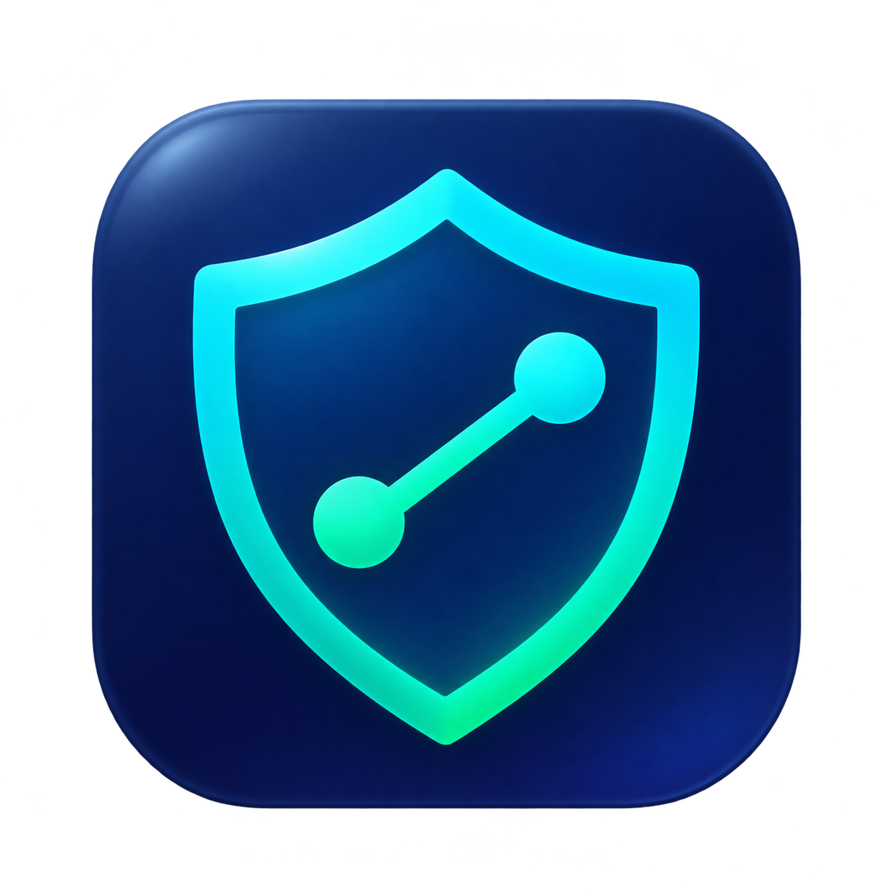

<div align="center">
  
  <h1>Route Shield</h1>
  <p>Проверяйте внешний IP перед запуском приложений на macOS.</p>
  <p><strong>Русский</strong> · <a href="README.en.md">English</a></p>
  <p><a href="https://github.com/01trisha/route-shield/releases">Скачать</a> · <a href="#из-исходников">Установить из исходников</a> · <a href="LICENSE">MIT License</a></p>
</div>

Route Shield живёт в строке меню. Вы выбираете приложения, для которых важен внешний IP, и запускаете их через меню щита или ярлыки в Dock. Меню и окно перед запуском показывают внешний IPv4, IPv6 и страну по IP.

- **Список приложений.** Перетащите приложения из Finder. Route Shield сам прочитает их Bundle ID.
- **Ярлыки для Dock.** Ярлык получает иконку оригинального приложения и открывает окно проверки IP.
- **Отслеживание IP.** В настройках можно отдельно включить уведомления и принудительное завершение выбранных приложений при смене адреса.
- **Русский и английский интерфейс.** Язык и запуск при входе меняются в отдельном окне настроек.

## Установка

**Минимальная версия — macOS 13 Ventura.** Готовая сборка рассчитана на Mac с Apple Silicon и Intel. Для запуска нужны доступ к интернету для проверки IP и системный `curl`, который входит в macOS. Для сборки из исходников нужны Git и Xcode Command Line Tools с SDK macOS 13 или новее. Подойдёт и полный Xcode. Homebrew, Python и другие пакеты не требуются. [Установка Command Line Tools](https://developer.apple.com/documentation/xcode/installing-the-command-line-tools/)

### Готовое приложение

1. В [GitHub Releases](https://github.com/01trisha/route-shield/releases) скачайте `Route-Shield-v…-macOS-universal.dmg` из списка **Assets**.
2. Откройте DMG и перетащите **Route Shield.app** на значок **Applications** внутри образа. Если скачали ZIP, распакуйте его и перенесите приложение в **Программы** вручную.
3. Откройте приложение из папки **Программы**. В строке меню появится щит.

Для каждого файла в релизе есть контрольная сумма SHA-256.

Сборка подписана локальной подписью ad hoc. Если Gatekeeper блокирует скачанную копию, воспользуйтесь установкой из исходников ниже. Для распространения с нотариальной проверкой Apple потребуется подпись Developer ID. [Документация Apple](https://developer.apple.com/documentation/security/notarizing-macos-software-before-distribution)

### Из исходников

На новом Mac запустите `xcode-select --install` и завершите установку в системном окне. Если инструменты уже установлены, переходите к командам ниже.

```sh
git clone https://github.com/01trisha/route-shield.git
cd route-shield
./install.sh
```

Скрипт проверит требования, соберёт приложение, скопирует его в `/Applications/Route Shield.app` и откроет. Если Command Line Tools отсутствуют, скрипт предложит установить их через macOS. После установки инструментов запустите скрипт ещё раз.

Если у вашей учётной записи нет права записи в `/Applications`, выполните `./install.sh --user`. Приложение установится в `~/Applications`. Флаг `--no-open` позволяет установить приложение и открыть его позже.

Перед обновлением выйдите из Route Shield через меню щита. Установщик заменит существующую копию приложения. Список приложений и настройки лежат отдельно.

## Первый запуск

В приветственном окне выберите язык и нажмите **Продолжить**. Если предпочитаемый язык macOS — русский, утилита предложит русский интерфейс, для остальных языков — английский.

1. Нажмите **щит → Добавить приложения…**. Откройте папку **Программы** в Finder и перетащите, например, Калькулятор в открывшееся окно.
2. Снова откройте меню щита и выберите Калькулятор. Дождитесь IPv4 и IPv6, затем нажмите **Открыть** или **Отмена**.
3. Чтобы запускать приложения из Dock, выберите **Создать или обновить ярлыки для Dock**. Перетащите ярлыки из `~/Applications/Route Shield` в Dock на место оригинальных значков.
4. Откройте **щит → Настройки…**. Во вкладке **Основные** можно выбрать, какие строки показывать в меню щита и окне перед запуском, сменить язык, включить запуск при входе или принудительное завершение. Во вкладке **Уведомления** включите уведомления, выберите их содержимое и отправьте пробный баннер. Во вкладке **О нас** есть ссылка на репозиторий.

Список приложений хранится в `~/Library/Application Support/VPN Guard/.env`. Это путь, который использовали ранние версии. Через **Открыть .env** можно вручную убрать ID из строки `APPS=` или дописать новый через запятую.

Если ярлыки были закреплены из старой папки `~/Applications/VPN Guard`, создайте их заново и закрепите экземпляры из `~/Applications/Route Shield`. Новые ярлыки используют выбранный в настройках язык.

После обновления приложения выберите **Создать или обновить ярлыки для Dock**, чтобы ярлыки получили новый код и переводы.

## Что проверяет Route Shield

Route Shield делает HTTPS-запросы к [ipify](https://www.ipify.org/) для IPv4 и [ifconfig.me](https://ifconfig.me/) для IPv6. Сервисы видят внешний адрес запроса. При раздельной маршрутизации у выбранного приложения может быть другой маршрут.

Для определения страны Route Shield отправляет найденные публичные IP-адреса в Country.is. Результат приблизительный. При разных странах для IPv4 и IPv6 меню и окно запуска показывают обе. Проверка страны выполняется отдельно от мониторинга и не задерживает кнопку **Открыть**. [Country.is](https://country.is/)

Если включено отслеживание, проверка запускается после сетевых событий macOS, выхода из сна и примерно раз в две минуты. Первый успешный результат задаёт точку отсчёта. Ошибка запроса сама по себе не считается сменой IP.

При обнаруженной смене адреса Route Shield отправляет одно уведомление с новым IP, страной или обоими значениями. Если включено принудительное завершение и приложения были закрыты, следом придёт одно уведомление с их названиями.

**Проверка перед запуском действует только через меню щита и его ярлыки.** Прямой запуск из Finder, Spotlight или через оригинальный значок Dock обходит её. Принудительное завершение срабатывает после обнаружения смены адреса. До этого приложение может успеть выйти в сеть, а при завершении можно потерять несохранённые данные.

## Сборка и выпуск

```sh
./build.sh      # Собрать .app для текущего Mac в build/
./package.sh    # Собрать универсальную .app, DMG, ZIP и контрольные суммы в build/
```

